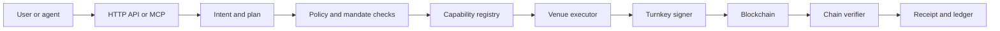

# Ava

**DeFi execution for AI agents, with user-defined limits and receipts checked against chain data.**

Ava helps an agent plan a financial action, execute it only through an enabled route, and show what the chain confirms. The hosted V4 product is at [getava.xyz](https://getava.xyz). This public repository contains earlier Ava agents and protocol projects; the source for the hosted V4 product is maintained separately in a private repository.

## 1. What this is and who it is for

Ava is an execution and verification layer for agents that interact with DeFi. It is for developers building financial agents, crypto-native users who want to delegate bounded actions, and teams that need a checkable record of agent activity.

The agent proposes an action. User-defined authority and deterministic checks govern whether Ava can execute it. The chain, rather than the agent's completion message, is the source of evidence for the result.

## 2. Story and inspiration

Ava began as a natural-language interface for multi-chain DeFi. Building agent workflows exposed a sharper problem: a confident “done” message is not proof that the transaction settled as intended or stayed within the user's limits.

V4 focuses on that boundary. The user sets the authority, the agent makes a proposal, and Ava returns evidence another person can check.

## 3. The problem

An agent can choose the wrong venue, misunderstand an amount, or report success when a transaction failed. A transaction hash establishes submission or inclusion. A receipt adds the evidence needed to check authorization and the resulting effect.

## 4. The solution

Ava combines agent-facing tools with bounded execution and chain-based verification. Its capability registry distinguishes implemented routes from routes that are enabled and reachable. Execution results are recorded as receipts that can be checked against public chain data.

## 5. How it works

1. A user or agent creates an Ava session and provisions a wallet for the needed chain family.
2. The agent sends a natural-language request through the HTTP API or MCP server.
3. Ava parses the request into an intent and plan, then checks policy, mandate, and route capability.
4. For an enabled lending route, Ava prepares the transaction for review and applies the route's execution gates.
5. The configured signer submits the transaction. Ava waits for chain evidence and records the settlement in a receipt.
6. The receipt can be checked against the transaction and the chain data used to describe it.

## 6. Target users

- **Agent developers** who need an execution API or MCP server for DeFi actions.
- **Crypto-native users** who want an agent to act within explicit limits.
- **Vault and treasury teams** that need to explain what an agent was allowed to do and what happened onchain.
- **Protocols and chain ecosystems** that want agent activity with a verifiable execution record.


## 7. Features

- **HTTP and MCP interfaces** for agent sessions, portfolios, plans, mandates, wallet provisioning, lending, and receipts.
- **Agent wallets** provisioned and signed through the configured wallet provider. The current production execution path uses Turnkey.
- **Mandate-bound lending execution** for Morpho on Base and Aave v3 on Avalanche, BNB Chain, Monad, and Arbitrum One.
- **Capability discovery** through a live registry that reports route reachability, operator enablement, and mainnet proof separately.
- **Chain-linked settlement records** with transaction and block evidence.
- **OpenClaw integration package** and MCP setup for compatible agent clients.

The production capability endpoint was checked on 2026-11-10. It reported five enabled lending routes. Four have a confirmed mainnet settlement in Ava's proof corpus. Aave v3 on Arbitrum One is enabled in the registry and reachable through API and MCP, with no mainnet settlement recorded.

## 8. Addresses and revenue

The following transactions are recorded in Ava's settlement registry. The site verification script re-reads each transaction from a public chain node and checks its status, called contract, and block.

| Chain | Venue and action | Contract called | Transaction |
| --- | --- | --- | --- |
| Base | Morpho gtUSDCp supply | [`0xee8f…4b61`](https://basescan.org/address/0xee8f4ec5672f09119b96ab6fb59c27e1b7e44b61) | [Supply](https://basescan.org/tx/0x97b78540cd233446b83fffacbdf7ab7e514446f914268c1fae14d5429e36bbba) |
| Base | Morpho gtUSDCp withdrawal | [`0xee8f…4b61`](https://basescan.org/address/0xee8f4ec5672f09119b96ab6fb59c27e1b7e44b61) | [Withdraw](https://basescan.org/tx/0xce4109e49eaa780588d0569c8886211132eee12377a1d16f22ba8b6d176b0a7f) |
| Avalanche | Aave v3 supply | [`0x794a…14ad`](https://snowtrace.io/address/0x794a61358d6845594f94dc1db02a252b5b4814ad) | [Transaction](https://snowtrace.io/tx/0x12990c11b1e8a7a7eff5e594823669a6778d2a6886474d29d7f5cf450bf4209f) |
| BNB Chain | Aave v3 supply | [`0x6807…e0cb`](https://bscscan.com/address/0x6807dc923806fe8fd134338eabca509979a7e0cb) | [Transaction](https://bscscan.com/tx/0x7737cf5cb76d1d4ac8e39f3ea4098a173534c259fb854dbc7ac991872608b9de) |
| BNB Chain | Aave v3 supply | [`0x6807…e0cb`](https://bscscan.com/address/0x6807dc923806fe8fd134338eabca509979a7e0cb) | [Transaction](https://bscscan.com/tx/0x46a0165a0744a1e70699effe9a8818b38f9414f65d1da4c620ef521de25f259c) |
| Monad | Aave v3 supply | [`0x69a5…2fef`](https://monadexplorer.com/address/0x69a5f9ad4f96ebf0a0c792dd42a01cc5c0102fef) | [Transaction](https://monadexplorer.com/tx/0x50940c9510bef0cb595ecaf2b40d57d4cfa04227b6568ded4ea0541abd8715cf) |
| Monad | Aave v3 supply | [`0x69a5…2fef`](https://monadexplorer.com/address/0x69a5f9ad4f96ebf0a0c792dd42a01cc5c0102fef) | [Transaction](https://monadexplorer.com/tx/0x1b23c35d5c7c58746961777fdc9eb468823be549a3784869ff0d71b326628af7) |
| BNB Chain | Historical SushiSwap via LI.FI swap | [`0x1231…4eae`](https://bscscan.com/address/0x1231deb6f5749ef6ce6943a275a1d3e7486f4eae) | [Transaction](https://bscscan.com/tx/0x14850931f8eb6a8adb1687d3065396bb26c297ad2d321fadfe59b1e73ede0542) |

These are protocol contracts called by recorded transactions, not an Ava token or treasury address. This README makes no claim about a token contract, token economics, or token utility.

**Revenue:** the current implementation has no billing path, and no revenue is verified here. The product notes propose charging for successful verified execution, with optional cost-based receipt anchoring and retention. Public receipt verification is intended to remain free.

## 9. Sponsors, partners, and integrations

**Technical integrations in the current product:** Turnkey wallet provisioning and signing; Morpho vault lending on Base; Aave v3 lending on Avalanche, BNB Chain, Monad, and Arbitrum One. The codebase also contains adapters for CoW Protocol, Jupiter, LI.FI, Across, Uniswap, Cetus, DeepBook, and Suilend. The live capability registry identifies which routes are enabled for execution.

Hackathon prizes from Flow, Wormhole, Hedera, Story, and Zircuit are listed in [Previous hackathon wins](#22-previous-hackathon-wins). They are historical awards, not current sponsorship or partnership agreements. I found no public evidence of an ongoing paid sponsorship agreement.

## 10. Tech stack

**Hosted V4 product:** TypeScript, Node.js, pnpm workspaces, Hono API services, MCP, a Mastra agent service, PostgreSQL-backed records, capability and policy packages, and protocol adapters. Turnkey is used in the current production wallet provisioning and signing path. The product also defines wallet-provider interfaces for integrations including Privy, DFNS, CDP, Safe, and external wallets.

**Public repository:** Rust for the NEAR Intents solver, TypeScript for the Eliza agent, and a Next.js frontend and Node.js server projects.

## 11. Architecture

The model proposes. Deterministic code applies policy and route gates. A configured signer submits the authorized transaction. A verifier reads chain data and records the result.



## 12. Competitors and alternatives

These products overlap with parts of Ava's workflow. They are alternatives to evaluate, not a claim that any one product has identical scope.

| Product | Overlapping use case |
| --- | --- |
| [Coinbase AgentKit and CDP Wallets](https://github.com/coinbase/agentkit) | Agent wallet actions and DeFi protocol integrations. CDP also provides configurable wallet policies. |
| [Rhinestone Smart Sessions](https://docs.rhinestone.dev/home/concepts/session-keys) | Owner-authorized session keys with contract, parameter, amount, and expiry restrictions. |
| [Brian](https://docs.brianknows.org/brian-api/apis/transaction) | Natural-language transaction planning and calldata for swaps, bridges, and DeFi actions. |
| [Enso](https://docs.enso.build/pages/build/get-started/overview) | DeFi routing and ordered transaction bundles for applications and agents. |
| [Nethermind DeFi Skills](https://github.com/NethermindEth/defi-skills) | Open-source DeFi transaction plans and local fork simulation. |
| [Chance](https://docs.chance.cc/concepts/verification.md) | Intent verification with signed receipts and optional chain anchoring. Its documented flow checks a proposed action; Ava's focus includes verifying settled chain effects. |

## 13. Go to market

Ava's distribution plan starts where agent builders already work:

1. Connect through MCP and the OpenClaw skill package.
2. Reach developers building agents that can sign or submit DeFi transactions.
3. Give vault, treasury, and protocol teams a public receipt they can inspect.
4. Work with chain ecosystems where a real user cohort asks for a supported route.


## 14. Business model

The current product has no active billing. The model under evaluation is a fee on a successful, verified settlement, with optional cost-based anchoring and retention for teams that need longer-lived records. The verification endpoint is designed as a free public trust surface. Ecosystem grants are treated as project funding, not recurring product revenue.

## 15. Roadmap

Priorities, without delivery-date promises:

1. Add execution routes only after calldata, signing, and settlement verification are proven together.
2. Validate repeat use with agent developers and teams that manage onchain capital.
3. Bring swaps and additional chain families to the same execution and receipt standard.
4. Test paid settlement and receipt-retention models with real buyers before enabling billing.

## 16. Team

**Kamal** is Ava's founder and builder. Follow his work on [GitHub](https://github.com/kamalbuilds) and [X](https://x.com/kamalbuilds).

## 17. Run locally

The hosted V4 source is maintained separately from this public repository. To run a public project, clone this repository and follow that project's own setup instructions. For the Eliza agent:

```bash
git clone https://github.com/getava-xyz/ava-the-ai-agent.git
cd ava-the-ai-agent/eliza-agent
pnpm install
cp .env.example .env
pnpm start
```

The Eliza project requires Node.js 22 or later and its own model or client credentials. The public repository has no single root-level application command.

## 18. Verify and test

The hosted API exposes read-only health and capability checks:

```bash
curl -fsS https://api.getava.xyz/health
curl -fsS https://api.getava.xyz/v1/capabilities
```

To discover the live MCP tool surface:

```bash
curl -fsS https://api.getava.xyz/mcp \
  -H 'content-type: application/json' \
  -d '{"jsonrpc":"2.0","id":1,"method":"tools/list","params":{}}'
```

In an authorized V4 source checkout, `pnpm test` runs workspace tests and `pnpm verify` runs type checks, tests, script tests, and architecture checks. The settlement verifier is `node apps/site/scripts/verify-settlements.mjs`; on 2026-11-10 it re-read all eight listed transactions and matched their status, contract, and block.

The older public projects maintain their own build and test commands in their manifests and READMEs.

## 19. Repository layout

| Path | Project |
| --- | --- |
| `eliza-agent/` | Eliza-based Ava agent |
| `near-ai-agents/` | NEAR ecosystem agent experiments |
| `runeswap-solver/` | Rust solver integration for RuneSwap and NEAR Intents |
| `eigenlayer/` | Portfolio-validation AVS project and related contracts |
| `frontend/` | Earlier Ava portfolio interface and integrations |
| `server/` | Earlier Ava server and agent services |
| `protocol-docs/` | Protocol integration notes |

## 20. Security notes

- User authority is represented as explicit policy and mandate data, not inferred from the model's text.
- A route must be enabled in the capability registry before its live executor can run.
- The current live lending tool requires a mandate and uses the configured signer provider.
- Settlement claims are checked against public chain data. The API distinguishes internal receipt integrity from chain-confirmed transaction evidence.
- Never put wallet secrets, API keys, or signing credentials in source, issues, or pull requests.
- The security notes above describe implementation controls; they are not an independent audit attestation.

## 21. License

There is no root-level license granting uniform rights across this repository. The Rust solver declares MIT in its `Cargo.toml`, and `eliza-agent/` has its own `LICENSE` file. Review the license and third-party notices for the specific project before reusing it.

## 22. Previous hackathon wins

**ETHDenver 2025:** Ava's earlier multi-chain DeFAI project received five prizes: first place in Wormhole's TypeScript SDK track, second place for Best DeFAI Project on Zircuit, third place in Story's AI Agents track, a Best Plugins to Eliza prize from Flow, and a Hedera Explorers bounty.

- [Devfolio project and prize records](https://devfolio.co/projects/ava-the-multichain-defai-agent-b640)
- [Zircuit's ETHDenver results](https://www.zircuit.com/en/blog/zircuit-at-ethdenver-2025-buidling-the-future-of-web3)
- [Hedera's ETHDenver bounty winners](https://hedera.com/blog/announcing-the-winners-of-eth-denver-2025-hedera-bounties/)

**Monad Devs, August 2026:** Ava was named among the winners of a ten-day build event. The [announcement](https://x.com/monad_dev/status/2088279638976127173) and [follow-up naming Ava by @kamalbuilds](https://x.com/monad_dev/status/2088279663512781164) link to the Monad product portal.

The ETHDenver prizes refer to Ava's earlier multi-chain DeFAI project. The Monad Devs event recognized the V4 portal.

## 23. Previous grants received

I found no public grant award announcement for Ava in the sources reviewed. Grant applications and prize winnings are not counted as grants received.

## 24. Public ecosystem posts mentioning Ava

- [Monad Devs names Ava among its build-event winners](https://x.com/monad_dev/status/2088279663512781164).
- [Hedera's official post links to its ETHDenver bounty winners](https://x.com/hedera/status/1897443490981622114).

These are official event and ecosystem references, not personal endorsements or investment recommendations.
